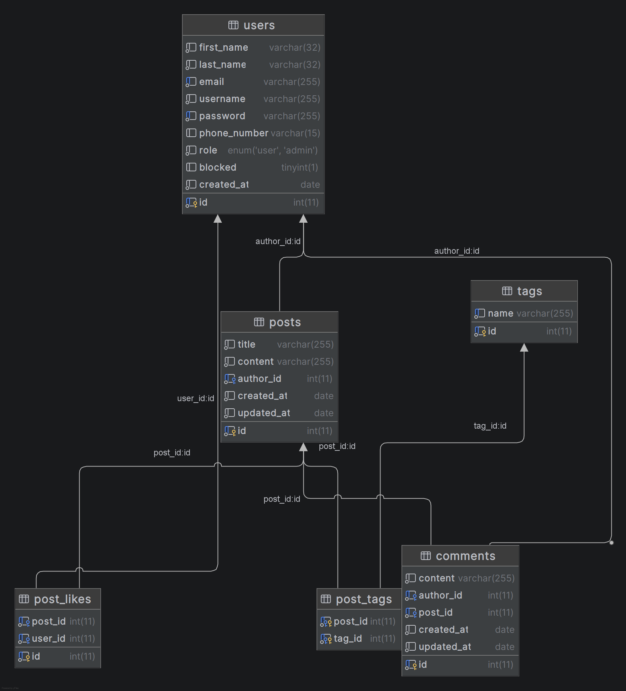

# CarsForum

A forum website for car enthusiasts. Users can create posts, comment, reply to comments, like posts, and add tags.

## Technologies used

- Java 17
- Spring Boot (Web, Data JPA, Security, Validation)
- Thymeleaf
- MariaDB
- Swagger
- Gradle
- JUnit + Mockito

## Swagger docs

`http://localhost:8080/swagger-ui.html`

## How to run it locally (Windows)

### You need
- JDK 17+
- MariaDB running on port 3306

### Steps

1. Clone the repo
```
git clone https://github.com/TelerikAcademyAlpha/CarsForum.git
cd CarsForum
```

2. Create the database and load the schema
```
mysql -u root -p -e "CREATE DATABASE post_forum"
mysql -u root -p post_forum < src\main\resources\schema.sql
mysql -u root -p post_forum < src\main\resources\insert_data.sql
```

If `mysql` is not recognized as a command, either add MariaDB's `bin` folder to your PATH, or call the full path directly, e.g.:
```
"C:\Program Files\MariaDB <version>\bin\mysql.exe" -u root -p -e "CREATE DATABASE post_forum"
```

3. If your DB username/password are different, update them in `src\main\resources\application.properties`.

4. Run the app
```
gradlew.bat bootRun
```

The app runs at `http://localhost:8080`.

## Database

MariaDB database with these tables: `users`, `posts`, `comments`, `tags`, `post_tags`, `post_likes`. Scripts are in `src\main\resources\schema.sql` and `insert_data.sql`.

### ER Diagram


## Project structure

```
src/main/java/com/backend/carsforum/
├── controllers/     # web (Thymeleaf) controllers
├── rest/            # REST API controllers
├── services/        # business logic
├── repositories/    # database access
├── models/          # entities
├── mapper/          # entity <-> DTO mappers
├── security/        # Spring Security setup
├── exceptions/      # exceptions + global handler
└── config/          # Hibernate, Swagger, Security config
```

## Main REST API endpoints

### Users (`/api/users`)
- `POST /register`, `POST /login`, `POST /logout`
- `GET /{id}`, `PUT /profile`
- `POST /{id}/block`, `POST /{id}/unblock`, `DELETE /{id}` (admin only)

### Posts (`/api/posts`)
- `POST /`, `PUT /{id}`, `DELETE /{id}`, `GET /{id}`, `GET /`
- `GET /latest`, `GET /top-commented`, `GET /search`
- `POST /{id}/like`, `DELETE /{id}/like`

### Comments (`/api/comments`)
- `POST /`, `PUT /{id}`, `DELETE /{id}`, `GET /{id}`
- `GET /post/{postId}`, `GET /author/{authorId}`, `POST /{parentId}/reply`

### Tags (`/api/tags`)
- `POST /`, `GET /{name}`, `GET /`

Full API docs are in Swagger.

## Tests

```
gradlew.bat test
```

## Team

- amishinev
- seyhan0126
- kirilvasilev00

Repo: https://github.com/TelerikAcademyAlpha/CarsForum
